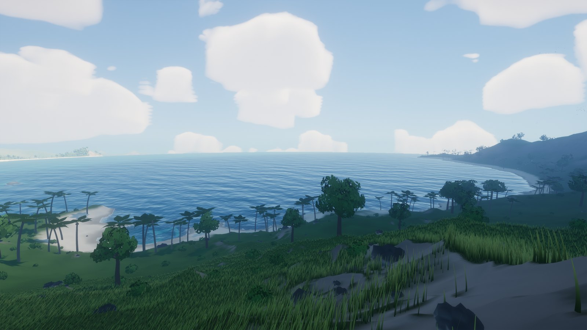
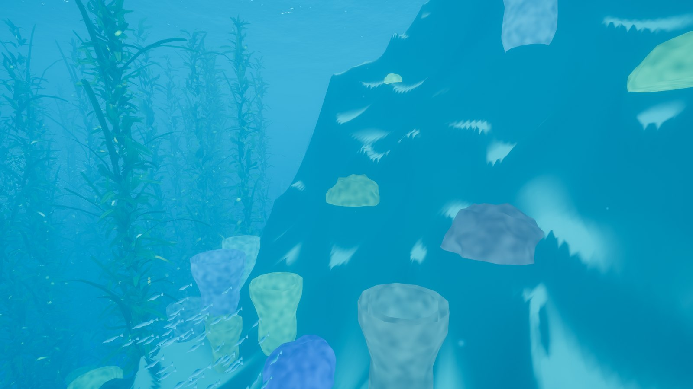

# Paradise Planet

**A tiny living planet you can fly around, right in your browser: from orbit down to the grass, and under the sea.**

Meadows of tall grass bending in the wind, palms on white beaches, clouds drifting over the hills, a sun that crosses
the day, and under the waves a garden of kelp and fish. All of it is made by code: no images, no 3D models, no sound
files. The whole planet fits in **one HTML file of about 150 KB**.


## Where it comes from

Paradise Planet is a small snapshot of **OpenG**, the engine I have been building for years (not public yet). OpenG
grew out of [FMeX](https://github.com/VincentGsell/FMeX), my earlier 3D framework for Delphi. The planet comes from there: the
cube-sphere and its level of detail, which I have reworked for years, the relief, the flight, the grass, the ocean
and the sun.

This browser version was written with an AI, Claude (Anthropic), from a prompt I wrote: [`prompt.txt`](prompt.txt)
([French version](prompt.fr.txt)). The AI ported the techniques of my engine to WebGPU in one HTML file. Then we tuned
it together, image after image, until it looked right.

## Try it

1. Download [`index.html`](index.html), or open the live page.
2. Open it in **Chrome** or **Edge** on a desktop computer.
3. Watch the arrival, from orbit down to a beach, then press **Fly**.

Nothing to install, and it works offline. It needs a browser with **WebGPU**.

## What's there

- **A whole planet**, round and seamless, 10 to 50 km across, with mountains, bays and lagoons, from orbit to 1.5 m above the ground
- **A physically based atmosphere**: blue sky, golden sunsets, stars and the Milky Way at night
- **Volumetric clouds** drifting with the wind, and their shadows running over the land and the sea
- **The sea**: real waves, foam on the shore, turquoise shallows, and a view from below through the surface
- **Life above the water**: grass, flowers, trees, palms, bushes and rocks, birds, a raptor gliding, butterflies,
  pollen in the sunbeams, fireflies at dusk
- **God rays**, above all at sunset, through the trees and the clouds
- **Life under the water**, 20 to 50 m deep: a forest of kelp, sea grass and soft corals, schools of fish
- **Time**: speed it up, slow it down or pause it, and watch the day go by

| | |
|---|---|
|  |  |
|  |  |
|  |  |

## Controls

| | Keyboard & mouse |
|---|---|
| Look around | Move the mouse |
| Fly | `W` `A` `S` `D` |
| Down / up | `Q` / `E` |
| Faster | Hold `Shift`, or the mouse wheel |
| Viewpoints | `1` to `8` |
| Time faster / slower / pause | `T` / `G` / `P` |
| Menu | `Esc` |
| Stats | `H` |

The keys are the ones at those places on your keyboard (`Z` `Q` `S` `D` on a French one), and the menu shows them as
printed on yours. To change one, click it in the menu and press the new key.

`Esc` opens the menu without leaving the world: the time of day, the size of the planet and the detail level are
there. Near the ground the horizon levels itself; out in space you can roll and loop freely.

## Detail levels

**Low**, **Medium** and **High** in the menu: the same planet, with less grass, fewer trees drawn far away, coarser
shadows and clouds. On every level the resolution adapts on its own to keep 60 fps.

## How it works

- **The planet** is a cube-sphere: six faces split into a quadtree of patches, finer near the camera, each one
  generated on the graphics card from a ridged multi-octave noise. Patches morph into each other, so there is no
  popping and no seam. Positions are kept in double precision on the CPU and everything is drawn relative to the
  camera, so there is no jitter, from orbit down to a blade of grass.
- **The atmosphere** is computed from the physics of light scattering (Hillaire 2020) into small lookup tables, scaled
  for a tiny planet.
- **The clouds** are ray-marched through a spherical shell, at reduced resolution and accumulated over frames.
- **The waves** are a real ocean spectrum turned into heights by an FFT on the graphics card, every frame.
- **Plants and animals** are not stored anywhere: every frame, the graphics card walks a grid anchored to the planet
  around the camera and grows them where the ground suits them. The same tree always comes back in the same place.
- **The sun's shadows** are three cascades around the camera; the god rays march through a low haze lit only where
  the sun gets through.

## Make it your own

The readable source code is in the [`source`](source) folder. To rebuild `index.html` you need
[Node.js](https://nodejs.org) 18 or newer:

```bash
cd source
npm install
npm run build
```

`npm run build:readable` writes an unminified `index.html`; `npm run build:dev` writes `dev.html` with test hooks.

## Credits

The underwater garden (the kelp leaves, the sea floor plants, the look of the water) is adapted from
[Abyssal Garden](https://github.com/Noniv/abyssal-garden) by Maksymilian Dendura, under the MIT License
([`LICENSES/abyssal-garden.txt`](LICENSES/abyssal-garden.txt)).
