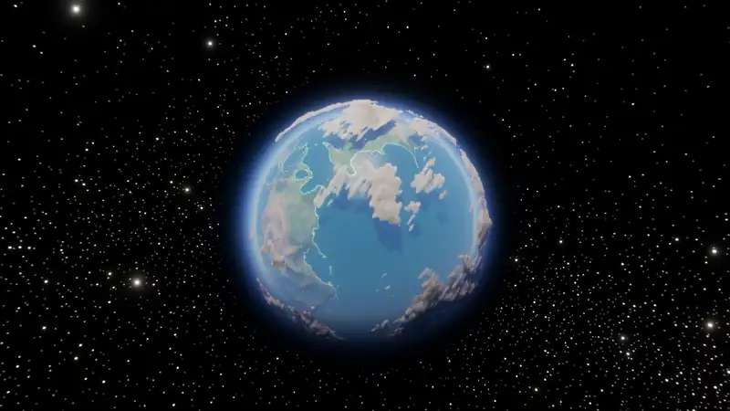
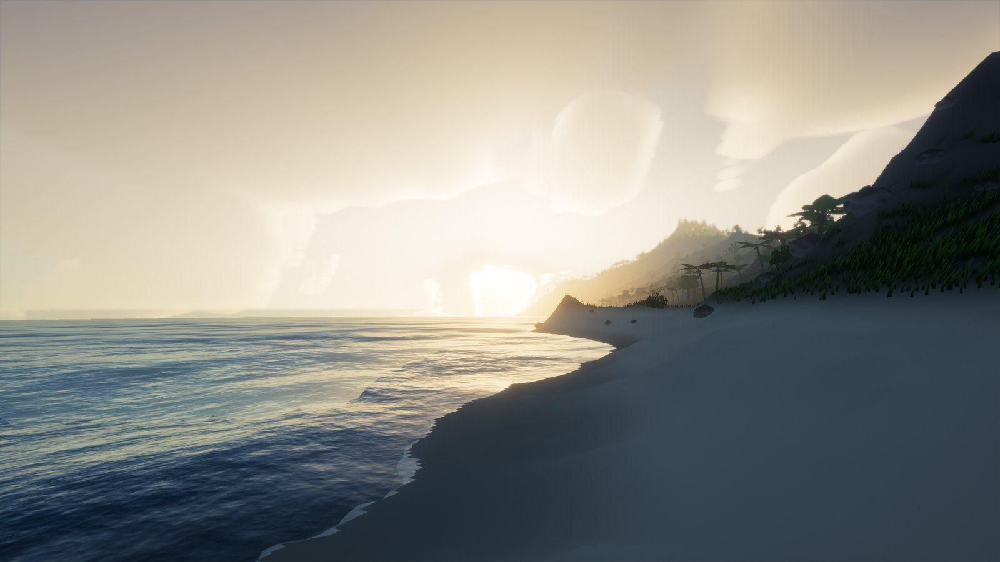
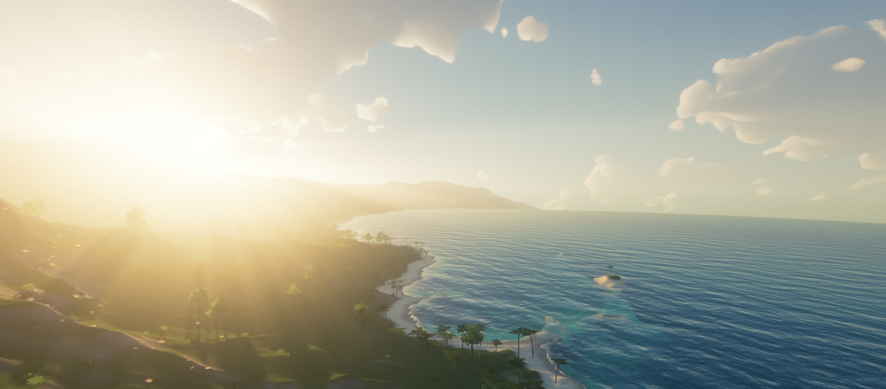
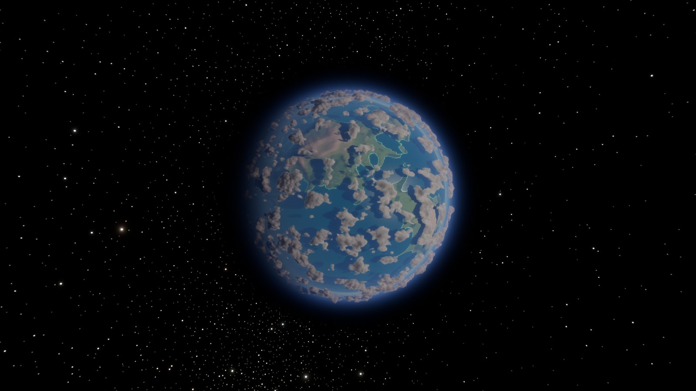
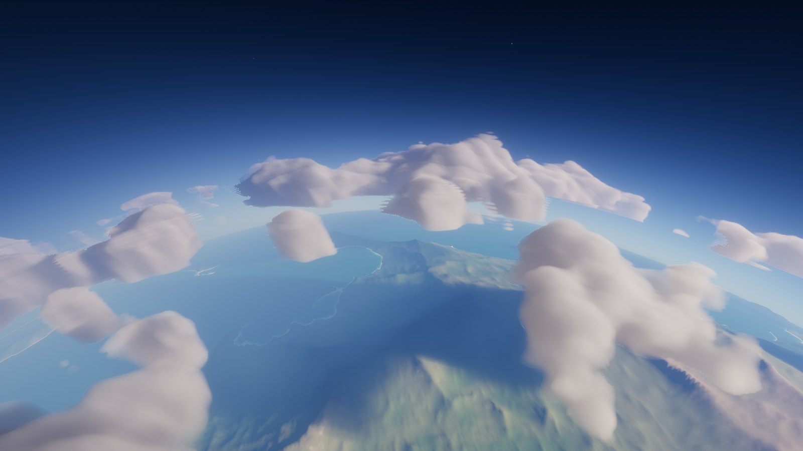
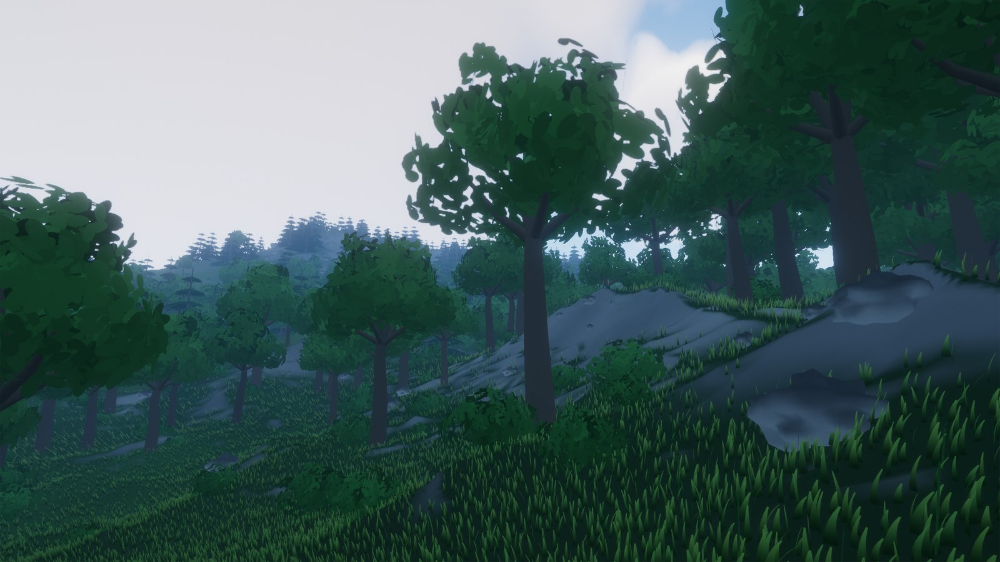
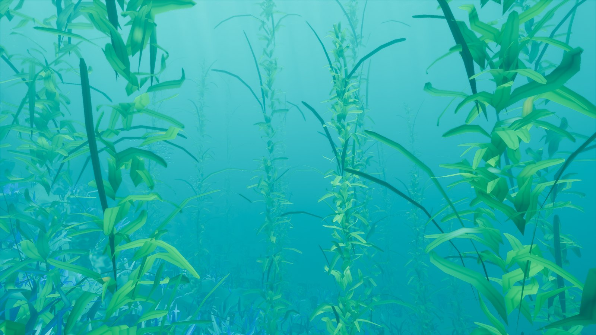
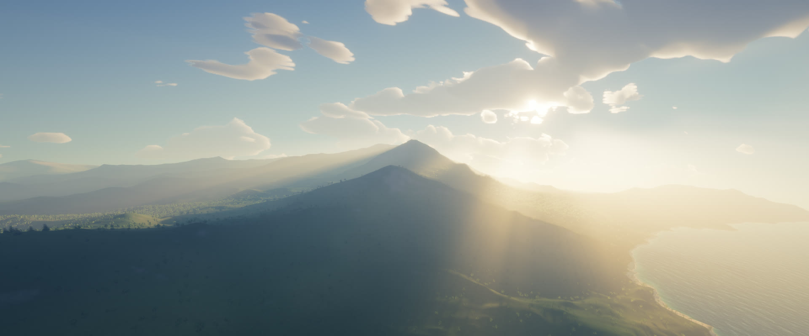

# Paradise Planet

*Une petite planète vivante à survoler dans le navigateur / A tiny living planet to fly around in your browser*

<p align="center"><a href="https://vincentgsell.github.io/paradise-planet/"></a></p>

<details>
<summary><b>🇬🇧 English</b></summary>

<!-- Ancienne présentation, en attendant la traduction de la version française. -->

**A tiny living planet you can fly around, right in your browser: from orbit down to the grass, and under the sea.**

Meadows of tall grass bending in the wind, palms on white beaches, clouds drifting over the hills, a sun that crosses
the day, and under the waves a garden of kelp and fish. All of it is made by code: no images, no 3D models, no sound
files. The whole planet fits in **one HTML file of about 150 KB**.



## Where it comes from

Paradise Planet is a small snapshot of **OpenG**, the engine I have been building for years (not public yet). OpenG
grew out of [FMeX](https://github.com/VincentGsell/FMeX), my earlier 3D framework for Delphi. The planet comes from there: the
cube-sphere and its level of detail, which I have reworked for years, the relief, the flight, the grass, the ocean
and the sun.

This browser version was written with an AI, Claude (Anthropic), from a prompt I wrote: [`prompt.txt`](prompt.txt)
([French version](prompt.fr.txt)). The AI ported the techniques of my engine to WebGPU in one HTML file. Then we tuned
it together, image after image, until it looked right.

## Try it

<h2 align="center"><a href="https://vincentgsell.github.io/paradise-planet/">▶ Try Paradise Planet in your browser</a></h2>

<p align="center"></p>

1. Open the [live page](https://vincentgsell.github.io/paradise-planet/), or download [`index.html`](index.html).
2. Open it in **Chrome** or **Edge** on a desktop computer.
3. Watch the arrival, from orbit down to a beach, then press **Fly**.

Nothing to install, and it works offline. It needs a browser with **WebGPU**.

## What's there

- **A whole planet**, round and seamless, 10 to 50 km across, with mountains, bays and lagoons, from orbit to 1.5 m above the ground
- **A physically based atmosphere**: blue sky, golden sunsets, stars and the Milky Way at night
- **Volumetric clouds** drifting with the wind, and their shadows running over the land and the sea
- **The sea**: real waves, foam on the shore, turquoise shallows, and a view from below through the surface
- **Life above the water**: grass, flowers, trees, palms, bushes and rocks, birds, a raptor gliding, butterflies,
  pollen in the sunbeams, fireflies at dusk
- **God rays**, above all at sunset, through the trees and the clouds
- **Life under the water**, 20 to 50 m deep: a forest of kelp, sea grass and soft corals, schools of fish
- **Time**: speed it up, slow it down or pause it, and watch the day go by

| | |
|---|---|
|  |  |
|  |  |
|  |  |

## Controls

| | Keyboard & mouse |
|---|---|
| Look around | Move the mouse |
| Fly | `W` `A` `S` `D` |
| Down / up | `Q` / `E` |
| Faster | Hold `Shift`, or the mouse wheel |
| Viewpoints | `1` to `8` |
| Time faster / slower / pause | `T` / `G` / `P` |
| Menu | `Esc` |
| Stats | `H` |

The keys are the ones at those places on your keyboard (`Z` `Q` `S` `D` on a French one), and the menu shows them as
printed on yours. To change one, click it in the menu and press the new key.

`Esc` opens the menu without leaving the world: the time of day, the size of the planet and the detail level are
there. Near the ground the horizon levels itself; out in space you can roll and loop freely.

## Detail levels

**Low**, **Medium** and **High** in the menu: the same planet, with less grass, fewer trees drawn far away, coarser
shadows and clouds. On every level the resolution adapts on its own to keep 60 fps.

## How it works

- **The planet** is a cube-sphere: six faces split into a quadtree of patches, finer near the camera, each one
  generated on the graphics card from a ridged multi-octave noise. Patches morph into each other, so there is no
  popping and no seam. Positions are kept in double precision on the CPU and everything is drawn relative to the
  camera, so there is no jitter, from orbit down to a blade of grass.
- **The atmosphere** is computed from the physics of light scattering (Hillaire 2020) into small lookup tables, scaled
  for a tiny planet.
- **The clouds** are ray-marched through a spherical shell, at reduced resolution and accumulated over frames.
- **The waves** are a real ocean spectrum turned into heights by an FFT on the graphics card, every frame.
- **Plants and animals** are not stored anywhere: every frame, the graphics card walks a grid anchored to the planet
  around the camera and grows them where the ground suits them. The same tree always comes back in the same place.
- **The sun's shadows** are three cascades around the camera; the god rays march through a low haze lit only where
  the sun gets through.

## Make it your own

The readable source code is in the [`source`](source) folder. To rebuild `index.html` you need
[Node.js](https://nodejs.org) 18 or newer:

```bash
cd source
npm install
npm run build
```

`npm run build:readable` writes an unminified `index.html`; `npm run build:dev` writes `dev.html` with test hooks.

## Credits

The underwater garden (the kelp leaves, the sea floor plants, the look of the water) is adapted from
[Abyssal Garden](https://github.com/Noniv/abyssal-garden) by Maksymilian Dendura, under the MIT License
([`LICENSES/abyssal-garden.txt`](LICENSES/abyssal-garden.txt)).

</details>

<details open>
<summary><b>🇫🇷 Français</b></summary>

<p align="center"></p>

## L'histoire

Depuis des années, j'essaie d'écrire un moteur 3D, dans différents langages, et surtout en Pascal. Le résultat de ce
travail, c'est le moteur [FMeX](https://github.com/VincentGsell/FMeX), dont la première version est toujours publiée
ici, sur GitHub. Il va bientôt être mis à jour : restez à l'affût !

Avec l'arrivée de l'IA et de sa capacité à écrire des programmes, j'ai voulu voir ce qu'elle ferait de mon moteur 3D,
qui sait afficher des planètes de façon assez poussée, et comment elle pourrait l'adapter au web, en le traduisant
directement en JavaScript « vanilla », sans aucune bibliothèque.

Paradise Planet est le résultat : le portage pour le web de mon moteur OpenG, et du moteur FMeX dont il est issu,
écrit par l'IA (Claude, d'Anthropic) à partir du prompt fourni ici : [`prompt.fr.txt`](prompt.fr.txt) (en anglais :
[`prompt.txt`](prompt.txt)). Ensuite, on l'a réglé ensemble, image après image.

## Comment ça marche, en gros

Toute la planète tient dans un seul fichier HTML d'environ 150 Ko. Il n'y a ni image, ni modèle 3D, ni son : tout est
fabriqué par le code, pendant que vous regardez. La carte graphique fait presque tout le travail. Elle sculpte le
relief, affine la planète là où vous regardez et la simplifie ailleurs, fait pousser l'herbe et les arbres là où le sol
s'y prête, lève les vagues et éclaire le tout comme le ferait une vraie atmosphère. Rien n'est stocké : si vous revenez
au même endroit, le même arbre aura repoussé au même endroit.

Et la planète n'est pas si petite :

| Planète | Diamètre | Surface | En mètres carrés |
|---|---|---|---|
| La plus petite (par défaut) | 10 km | environ 314 km² | 314 159 265 m² (oui, ce sont les décimales de π) |
| La plus grande | 50 km | environ 7 854 km² | 7 853 981 634 m² |

Avec ses 7 854 km², la plus grande offre plus de surface que GTA 6, et de loin : quelle que soit l'estimation qu'on
prend pour la carte de Leonida, elle tient plus de vingt fois dedans. D'accord, on compte la mer. Mais la mer, on peut
plonger dedans.

## Le ciel et la météo

Le ciel vient du moteur FMeX (en Pascal), qui a ensuite été porté dans le moteur OpenG (en Rust), bientôt publié lui
aussi. On y retrouve :

- **l'atmosphère**, calculée à partir de la physique de la lumière qui traverse l'air : ciel bleu à midi, couchers de
  soleil dorés, étoiles et Voie lactée la nuit. Elle est mise à l'échelle d'une planète minuscule ;
- **le soleil**, qui traverse la journée. On peut accélérer le temps, le ralentir ou le mettre en pause ;
- **les nuages**, de vrais volumes et pas des images collées sur le ciel : des cumulus de beau temps posés dans une
  couche qui entoure la planète, plus hauts sur une grande planète, et qu'on peut survoler sur une petite ;
- **le vent**, qui pousse lentement les nuages autour de la planète. Leurs ombres courent sur la terre et sur la mer ;
- **la mer**, dont les vagues sont calculées à partir d'un alizé de 6,5 m/s, comme sur un vrai océan.

Pour l'instant, il fait toujours beau : pas encore de pluie ni d'orage.

## Merci à

- **[Abyssal Garden](https://github.com/Noniv/abyssal-garden)**, de Maksymilian Dendura (Noniv) : un jardin sous-marin
  généré par le code, en WebGPU, dans un seul fichier HTML. Paradise Planet est construit de la même façon, et nos
  fonds marins (les feuilles de kelp, les plantes du fond, la couleur de l'eau) en sont adaptés. Il est publié sous
  licence MIT ([`LICENSES/abyssal-garden.txt`](LICENSES/abyssal-garden.txt)).
- Les travaux publiés dont le moteur s'inspire : le modèle d'atmosphère de Sébastien Hillaire (2020), les nuages
  « Nubis » de Guerrilla Games et les vagues de Jerry Tessendorf (spectre JONSWAP, calculé par FFT).

Enjoy ! :)

<h2 align="center"><a href="https://vincentgsell.github.io/paradise-planet/">▶ Essayer Paradise Planet dans le navigateur</a></h2>

<p align="center">Chrome ou Edge sur un ordinateur, avec WebGPU. Rien à installer.</p>

<p align="center"></p>

## Ce qu'on y trouve

- **Une planète entière**, ronde et sans couture, de 10 à 50 km de diamètre, avec ses montagnes, ses baies et ses
  lagons, qu'on voit de l'orbite jusqu'à 1,5 m du sol
- **Une atmosphère physique** : ciel bleu, couchers de soleil dorés, étoiles et Voie lactée la nuit
- **Des nuages en volume** qui avancent avec le vent, et leurs ombres sur la terre et la mer
- **La mer** : de vraies vagues, l'écume sur le rivage, les eaux turquoise des hauts-fonds, et la surface vue d'en
  dessous
- **La vie hors de l'eau** : herbe, fleurs, arbres, palmiers, buissons et rochers, oiseaux, un rapace qui plane,
  papillons, pollen dans les rayons du soleil, lucioles au crépuscule
- **Des rayons de soleil** à travers les arbres et les nuages, surtout au coucher
- **La vie sous l'eau**, de 20 à 50 m de profondeur : une forêt de kelp, des herbiers, des coraux mous, des bancs de
  poissons
- **Le temps** : on l'accélère, on le ralentit ou on le met en pause, et on regarde la journée passer

| | |
|---|---|
|  |  |
|  |  |
|  |  |

## Essayer

1. Ouvrez la [page en ligne](https://vincentgsell.github.io/paradise-planet/), ou téléchargez
   [`index.html`](index.html).
2. Ouvrez-la dans **Chrome** ou **Edge**, sur un ordinateur.
3. Regardez l'arrivée, de l'orbite jusqu'à une plage, puis appuyez sur **Fly** (la page est en anglais).

Il n'y a rien à installer, et le fichier téléchargé marche sans connexion. Il faut un navigateur qui gère **WebGPU**.

## Commandes

| | Clavier et souris |
|---|---|
| Regarder autour | Bouger la souris |
| Voler | `Z` `Q` `S` `D` |
| Descendre / monter | `A` / `E` |
| Plus vite | Maintenir `Maj`, ou la molette |
| Points de vue | `1` à `8` |
| Temps plus vite / moins vite / pause | `T` / `G` / `P` |
| Menu | `Échap` |
| Statistiques | `H` |

Les touches sont repérées par leur place sur le clavier (sur un clavier QWERTY, on vole avec `W` `A` `S` `D`), et le
menu les affiche telles qu'elles sont gravées sur le vôtre. Pour en changer une, cliquez dessus dans le menu, puis
appuyez sur la nouvelle touche.

`Échap` ouvre le menu sans quitter le monde : on y règle l'heure, la taille de la planète et le niveau de détail. Près
du sol, l'horizon se remet droit tout seul ; dans l'espace, on peut tourner et faire des loopings librement.

## Niveaux de détail

**Low**, **Medium** et **High** dans le menu : c'est la même planète, avec moins d'herbe, moins d'arbres au loin, des
ombres et des nuages plus grossiers. À chaque niveau, la résolution s'adapte toute seule pour garder 60 images par
seconde.

## Comment c'est fait

- **La planète** est une sphère-cube : six faces découpées en un arbre de morceaux (un quadtree), plus fins près de la
  caméra, et chacun est généré par la carte graphique à partir d'un bruit à plusieurs octaves, avec des crêtes. Les
  morceaux se fondent les uns dans les autres en changeant de finesse : rien ne surgit d'un coup et on ne voit pas de
  couture. Les positions sont gardées en double précision sur le processeur et tout est dessiné par rapport à la
  caméra : rien ne tremble, de l'orbite jusqu'au brin d'herbe.
- **L'atmosphère** est calculée à partir de la physique de la diffusion de la lumière (Hillaire 2020), dans de petites
  tables précalculées, à l'échelle d'une toute petite planète.
- **Les nuages** sont parcourus par des rayons à travers une coquille sphérique, en résolution réduite, et accumulés
  d'une image à l'autre.
- **Les vagues** viennent d'un vrai spectre d'océan, transformé en hauteurs par une FFT sur la carte graphique, à
  chaque image.
- **Les plantes et les animaux** ne sont stockés nulle part : à chaque image, la carte graphique parcourt une grille
  attachée à la planète autour de la caméra, et les fait pousser là où le sol leur convient. Le même arbre revient
  toujours à la même place.
- **Les ombres du soleil** sont faites de trois cascades autour de la caméra ; les rayons de soleil traversent une
  brume basse, éclairée seulement là où le soleil passe.

## À vous de jouer

Le code source, lisible, est dans le dossier [`source`](source). Pour reconstruire `index.html`, il faut
[Node.js](https://nodejs.org) 18 ou plus récent :

```bash
cd source
npm install
npm run build
```

`npm run build:readable` écrit un `index.html` non minifié ; `npm run build:dev` écrit `dev.html`, avec les points
d'accès pour les tests.

## Crédits

Le jardin sous-marin (les feuilles de kelp, les plantes du fond, la couleur de l'eau) est adapté
d'[Abyssal Garden](https://github.com/Noniv/abyssal-garden), de Maksymilian Dendura, sous licence MIT
([`LICENSES/abyssal-garden.txt`](LICENSES/abyssal-garden.txt)).

</details>
